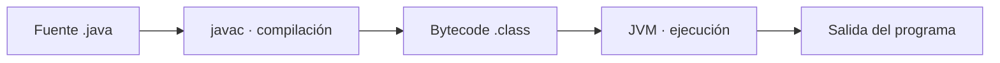

# Sesión 1 · Introducción, configuración y variables básicas

En esta sesión ejecutarás tu primer programa Java, representarás datos con variables y comprobarás resultados. Trabajaremos con IntelliJ IDEA, sin Maven ni Gradle. El material usa sintaxis compatible con JDK 17 y 21; JDK 21 sigue siendo la referencia del curso.

## Qué aprenderás

- Distinguir JDK, compilador, bytecode, JVM e IDE.
- Reconocer la clase y el método principal de un programa.
- Elegir tipos básicos y diferenciar declaración, inicialización y reasignación.
- Usar `print`, `println`, `final` y reconocer la inferencia local con `var`.
- Predecir resultados, leer errores y observar variables con el depurador.

## Antes de comenzar

1. Actualiza el repositorio oficial con `git pull`.
2. Comprueba `java -version` y `javac -version`: para esta sesión trabajaremos con JDK 21.
3. Localiza la sesión en `src/01-fundamentos-java/sesion-01-introduccion-configuracion-variables/`. Copia el material a una carpeta personal fuera del repositorio oficial para resolver los labs.
4. En IntelliJ IDEA crea un proyecto **Java**, selecciona JDK 21 como Project SDK y **IntelliJ** como sistema de construcción. No selecciones Maven ni Gradle ni agregues código de ejemplo automático.
5. Copia los archivos `.java` de `demo/` y `labs/` al directorio `src` de tu proyecto personal. Cada clase tiene un nombre distinto y su propio `main`.
6. Abre la clase que quieras ejecutar y usa **Run** junto a su método `main`. Comprueba que ejecutas la clase correcta.

El JDK del proyecto es distinto del runtime con el que funciona el propio IDE. Este material también compila con JDK 17 si ese es el SDK que ya tienes seleccionado; no uses un Language level superior al JDK de tu proyecto.

### Abrir el repositorio con su organización por sesiones

Si abres el repositorio completo como proyecto IntelliJ, las carpetas de módulos y sesiones bajo `src/` organizan el material del curso; no son paquetes Java. Sus nombres contienen guiones y no deben convertirse en declaraciones `package`.

1. Si `src/` está marcado como **Sources Root**, desmarca esa raíz en **Mark Directory as → Unmark as Sources Root**.
2. Marca `demo/` y `labs/` de esta sesión como **Sources Root**. También puedes hacerlo en **File → Project Structure → Modules → Sources**.
3. Las clases de esta sesión no tienen declaración `package`: cada archivo está directamente dentro de su propia raíz de código. Es una simplificación para comenzar; los paquetes se incorporarán posteriormente.
4. Abre una clase y ejecuta su propio `main`. Si Run no está disponible, revisa el Project SDK y las raíces de código.

Al crear un proyecto personal con los archivos copiados directamente en su `src/`, sí debes dejar ese `src/` como Sources Root. En sesiones futuras marca sus carpetas de código de la misma manera, evitando nombres de clase repetidos dentro de un mismo módulo.

## Cómo llega el código a ejecutarse



El **JDK** aporta `javac`, `java` y otras herramientas. La **JVM** ejecuta bytecode. **IntelliJ IDEA** ayuda a editar, compilar, ejecutar y depurar; no sustituye al JDK. Un programa que compila todavía puede producir un resultado incorrecto: hay que comprobarlo.

## Anatomía de un programa

```java
public class HolaMundo {
    public static void main(String[] args) {
        System.out.println("Hola, mundo!");
    }
}
```

| Elemento | Qué significa en este ejemplo |
| --- | --- |
| `public class HolaMundo` | Declara una clase pública llamada HolaMundo; el archivo se llama `HolaMundo.java`. |
| `public` del método | Permite acceder al método desde fuera de la clase. |
| `static` | Permite invocar el método sin crear un objeto de la clase; profundizaremos en POO. |
| `void` | El método no devuelve un valor. |
| `main` | Nombre del punto de entrada tradicional que usaremos en el curso. Respeta las minúsculas. |
| `String[] args` | Parámetro que recibe los argumentos de la ejecución como un arreglo de textos. No lo usaremos todavía; `args` es su nombre. |
| `{` y `}` | Delimitan los bloques de la clase y del método. |
| `System.out.println(...)` | Escribe en la salida estándar y añade un salto de línea. `print` escribe sin añadirlo. |
| `;` | Cierra la sentencia mostrada; las llaves de clase y método no llevan punto y coma. |
| `// TODO` | Es un comentario con una tarea pendiente. No se ejecuta; debes completar lo que solicita. |

## Variables y tipos

| Tipo | Dato apropiado | Ejemplo |
| --- | --- | --- |
| `String` | Texto; es una clase, no un primitivo | `String nombre = "Ana";` |
| `int` | Entero | `int edad = 20;` |
| `double` | Medición decimal aproximada | `double temperatura = 23.5;` |
| `boolean` | Estado verdadero o falso | `boolean activo = true;` |
| `char` | La inicial usada en estos ejercicios | `char inicial = 'A';` |

Java tiene ocho tipos primitivos; aquí practicaremos cuatro. Los otros son `byte`, `short`, `long` y `float`. `char` almacena una unidad UTF-16: no todos los símbolos, como ciertos emojis, caben en un solo `char`.

- **Declaración:** `int intentos;` define nombre y tipo.
- **Inicialización:** `intentos = 1;` proporciona su primer valor.
- **Reasignación:** `intentos = 2;` cambia el valor manteniendo el tipo.
- **`final`:** impide reasignar una variable después de inicializarla.
- **`var`:** infiere el tipo de una variable local a partir de su inicializador. `var ciudad = "Cucuta";` sigue siendo `String`; no admite después un entero. En los labs usa tipos explícitos para practicar su elección.

Usaremos `+` únicamente para unir etiquetas y datos en la salida. Los cálculos, decisiones, ciclos, entrada por teclado y conversiones se estudiarán en otras sesiones.

## Tres demos

| Archivo | Qué observar | Comprobación |
| --- | --- | --- |
| [HolaMundo.java](demo/HolaMundo.java) | Clase, main y primera salida | Predice `Hola, mundo!`, cambia el saludo y observa un error al quitar temporalmente `;`. |
| [MiPrimeraFicha.java](demo/MiPrimeraFicha.java) | Cinco tipos y salida con etiquetas | Predice la ficha, ejecuta y modifica solo los valores. |
| [LosDatosCambian.java](demo/LosDatosCambian.java) | Inicialización, reasignación, final y var | Inspecciona `intentos` antes y después de cambiar de 1 a 2. |

### Tu primer breakpoint

En `LosDatosCambian.java`, coloca un breakpoint en `intentos = 2;` y usa **Debug**. La ejecución pausa antes de ejecutar esa línea: `intentos` vale 1. Usa **Step Over** para ejecutarla y comprueba que vale 2. Usa **Resume** para terminar. Si activas una línea comentada que provoca un error, vuelve a comentarla antes de continuar.

## Trabajo en clase y en casa

El bloque de laboratorios tendrá **un máximo de 40 minutos**. El resto de la clase se dedica a conceptos, demos, preguntas y retroalimentación.

| Minutos del bloque de práctica | Actividad |
| --- | --- |
| 0–8 | Lab 1: saludo |
| 8–18 | Lab 2: salida |
| 18–35 | Lab 3: variables |
| 35–40 | Revisión breve y guardar avances |

Consulta [los cinco laboratorios](labs/README.md). Empieza por los labs 1–3; completa en casa lo que no alcances y los labs 4–5. Trae los cinco terminados para la siguiente clase. Las pruebas marcadas como opcionales no son requisito de entrega.
## Cómo completar los labs sin perderte

1. Abre [la guía detallada de laboratorios](labs/README.md) y busca el número del lab que estás trabajando.
2. Abre el archivo Java enlazado en esa actividad. Escribe las instrucciones dentro de main; no copies el bloque de salida esperada como si fuera código.
3. Sigue los pasos numerados en orden. Cada actividad indica los datos que debes usar, las variables o decisiones que debes construir y las etiquetas de los println.
4. Ejecuta la clase actual después de cada bloque pequeño. Compara la salida y corrige antes de continuar.
5. Haz las ejecuciones indicadas en la tabla de pruebas, cambiando los datos iniciales. Registra entradas, salida esperada y salida observada en el README de tu repositorio personal.
6. Revisa el apartado **Terminado cuando** antes de pasar al siguiente lab. Completar un TODO implica implementarlo y comprobarlo, no solo borrarlo.

## Entrega y comprobación final

Sube tus cinco clases completadas a tu repositorio personal y agrega un README con las pruebas y explicaciones solicitadas. Entrega su enlace en Campus. Usa datos ficticios; no necesitas publicar información personal real.

Antes de entregar, comprueba que puedes:

- Ejecutar cada clase por separado y explicar dónde comienza.
- Distinguir `print` y `println`, `String` y `char`, inicialización y reasignación.
- Explicar por qué `int edad = "20";` no compila.
- Explicar por qué `var` no permite cambiar el tipo y qué impide `final`.
- Mostrar una predicción, un error diagnosticado y una variable observada con Debug.

No subas `.idea/`, archivos `.iml`, `out/` ni `.class`. Las entregas se hacen en tu repositorio personal, no en el oficial del docente.
