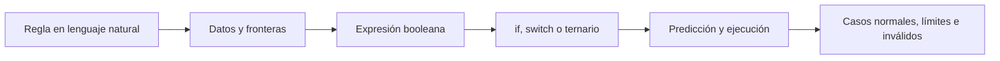

# Sesión 2 · Operadores y estructuras de decisión

En esta sesión pasarás de almacenar datos a calcular, comparar y elegir caminos. El bloque de laboratorios tendrá **un máximo de 40 minutos**; el resto de la clase se dedica a teoría, demos, preguntas y revisión, usando IntelliJ IDEA, sin Maven ni Gradle.

## Objetivos

- Predecir resultados aritméticos y distinguir división entera de decimal.
- Traducir reglas a condiciones con comparaciones, &&, || y !.
- Decidir con if/else, ordenar rangos y reconocer sus fronteras.
- Elegir switch para opciones discretas y ternario para dos valores simples.
- Probar casos normales, límites e inválidos y explicar qué ocurrió.

## Preparación e IntelliJ

1. Actualiza el repositorio con `git pull` y trabaja en una copia personal para completar los labs.
2. Localiza el material en `src/01-fundamentos-java/sesion-02-operadores-estructuras-decision/`.
3. Usa JDK 21 como referencia; las clases también son compatibles con Java 17. Project SDK y Language level deben ser compatibles.
4. Si conservas la organización por módulos y sesiones, deja el `src/` general como carpeta organizadora y marca `demo/` y `labs/` de esta sesión como **Sources Root** en **Project Structure → Modules → Sources**.
5. Si copias las clases directamente al `src/` de un proyecto personal Java sencillo, marca ese `src/` como Sources Root. No agregues declaraciones package con los nombres de carpetas que contienen guiones.
6. Ejecuta la clase correcta con Run junto a su main. Los nombres S02 evitan colisiones con la sesión 1.

No usamos entrada por teclado, ciclos ni métodos auxiliares. Para probar otro caso, cambia los valores iniciales y ejecuta de nuevo. Los tipos de entrega son textos no null escritos exactamente en mayúsculas.

## De una regla a una decisión

Antes de escribir la condición, pregunta: ¿qué debe pasar exactamente en el límite? Para “al menos 18”, prueba 17, 18 y 19; no basta con un valor lejano a la frontera.

## Operadores esenciales

| Grupo | Operadores | Idea clave |
| --- | --- | --- |
| Asignación | = | Guarda un valor; no compara. |
| Aritmética | +, -, *, /, % | Calcula; % es resto, no porcentaje. |
| Incremento/decremento | ++, -- | Cambia una variable en una unidad. Prefiere sentencias separadas al comenzar. |
| Comparación | ==, !=, >, >=, <, <= | Produce un boolean. |
| Lógica | &&, ||, ! | Combina o niega condiciones. |
| Ternario | condición ? valorA : valorB | Elige uno de dos valores simples. |

### División y precedencia

`7 / 2` produce 3; `7.0 / 2` produce 3.5. Asignar `7 / 2` a double no recupera la fracción que la división entera ya descartó. `7 % 2` produce 1. En `2 + 3 * 4` la multiplicación tiene prioridad: resultado 14; `(2 + 3) * 4` produce 20.

`contador++` produce el valor anterior y después incrementa; `++contador` incrementa primero y produce el nuevo valor. Cuando se usan como sentencias separadas, ambas formas incrementan una unidad.

### Lógica y cortocircuito

- `a && b`: ambas condiciones deben ser verdaderas; si a es falsa, b no se evalúa.
- `a || b`: basta una verdadera; si a es verdadera, b no se evalúa.
- `!a`: invierte el boolean.

`divisor != 0 && 10 / divisor > 2` protege la división: con divisor cero, la segunda expresión se omite. Invertir ese orden elimina la protección.

Usa paréntesis para mostrar intención: `edad >= 18 && (esMiembro || tieneInvitacion) && !bloqueado` exige edad, una autorización y ausencia de bloqueo.

## Elegir una estructura

| Problema | Estructura | Precaución |
| --- | --- | --- |
| Una condición y dos caminos | if/else | La condición debe producir boolean. |
| Rangos distintos | if/else if/else | Ejecuta la primera condición verdadera; ordena las fronteras y valida datos. |
| Un valor entre opciones discretas | switch | Maneja opciones desconocidas con default. |
| Elegir dos valores breves | Ternario | Evita anidarlo o esconder lógica compleja. |

El switch clásico con `case ...:` requiere break para evitar continuar accidentalmente hacia otro caso. Los casos con `->` no tienen ese fall-through. En esta sesión también verás switch como expresión que devuelve un valor.

Para comparar contenido de texto usa `"RECOGIDA".equals(tipoEntrega)`; `==` entre referencias no representa esa comparación de contenido. En enteros y booleanos, == compara sus valores. No necesitas otros métodos de cadenas para estas actividades.

## Tres demos: 60 minutos

| Minutos | Archivo | Pregunta antes de ejecutar |
| --- | --- | --- |
| 0–20 | [S02DemoOperadores.java](demo/S02DemoOperadores.java) | ¿Qué diferencia hay entre división entera, decimal y resto? |
| 20–40 | [S02DemoDecisiones.java](demo/S02DemoDecisiones.java) | ¿Qué rama se ejecuta exactamente en 18 o 90? ¿Se evalúa una división por cero? |
| 40–60 | [S02DemoOpciones.java](demo/S02DemoOpciones.java) | ¿Dan el mismo costo las dos formas de switch? ¿Qué pasa con DRON? |

En la demo de opciones, -1 es una señal interna de opción desconocida; no se presenta como un precio válido. Todos los costos están en centavos.

## Laboratorios: máximo 40 minutos en clase

Consulta [la guía de cinco labs](labs/README.md). Los labs 1–3 son la prioridad del bloque de clase. No es obligatorio terminarlos dentro de los 40 minutos: guarda los avances y completa lo pendiente en casa, junto con los labs 4 y 5, para la siguiente clase.

| Minutos del bloque de práctica | Trabajo |
| --- | --- |
| 0–10 | Lab 1: operadores |
| 10–22 | Lab 2: acceso |
| 22–37 | Lab 3: categorías |
| 37–40 | Revisión breve y guardar avances |

Realiza solo las pruebas mínimas obligatorias de cada lab. La matriz ampliada, comparar dos formas de switch y las tareas adicionales de Debug son opcionales. No añadas funcionalidades para terminar antes.
## Cómo completar los labs sin perderte

1. Abre [la guía detallada de laboratorios](labs/README.md) y busca el número del lab que estás trabajando.
2. Abre el archivo Java enlazado en esa actividad. Escribe las instrucciones dentro de main; no copies el bloque de salida esperada como si fuera código.
3. Sigue los pasos numerados en orden. Cada actividad indica los datos que debes usar, las variables o decisiones que debes construir y las etiquetas de los println.
4. Ejecuta la clase actual después de cada bloque pequeño. Compara la salida y corrige antes de continuar.
5. Haz las ejecuciones indicadas en la tabla de pruebas, cambiando los datos iniciales. Registra entradas, salida esperada y salida observada en el README de tu repositorio personal.
6. Revisa el apartado **Terminado cuando** antes de pasar al siguiente lab. Completar un TODO implica implementarlo y comprobarlo, no solo borrarlo.

## Importes del laboratorio

Para el caso de promociones usamos long y centavos enteros: 10_000 centavos representan 100 unidades monetarias. El guion bajo mejora la lectura del literal y no cambia su valor.

La regla de esta actividad es descartar cualquier fracción de centavo del descuento. Con importes no negativos, `subtotalCentavos * porcentajeDescuento / 100` aplica esa regla. El subtotal está acotado a 1_000_000 centavos para mantener el ejercicio controlado. No usamos double para dinero ni presentamos este diseño como una política universal de redondeo.

## Depuración y entrega

Coloca un breakpoint en una condición y usa Step Over para ver qué rama se ejecuta. En promociones, observa el descuento, el neto y el envío antes del total. Cambia una entrada a la vez para explicar la causa del resultado.

Entrega en tu repositorio personal las cinco clases completas y un README breve con las pruebas mínimas, resultados y una explicación de un operador o decisión por lab. Completa lo pendiente en casa y tráelo para la siguiente clase. Comparte el enlace en Campus. No publiques configuración del IDE ni archivos compilados.

Al finalizar debes poder explicar = frente a ==, > frente a >=, && frente a ||, el orden de else if y cuándo elegir switch o ternario. Compilar no demuestra que una regla sea correcta: tus pruebas deben cubrir sus fronteras.
