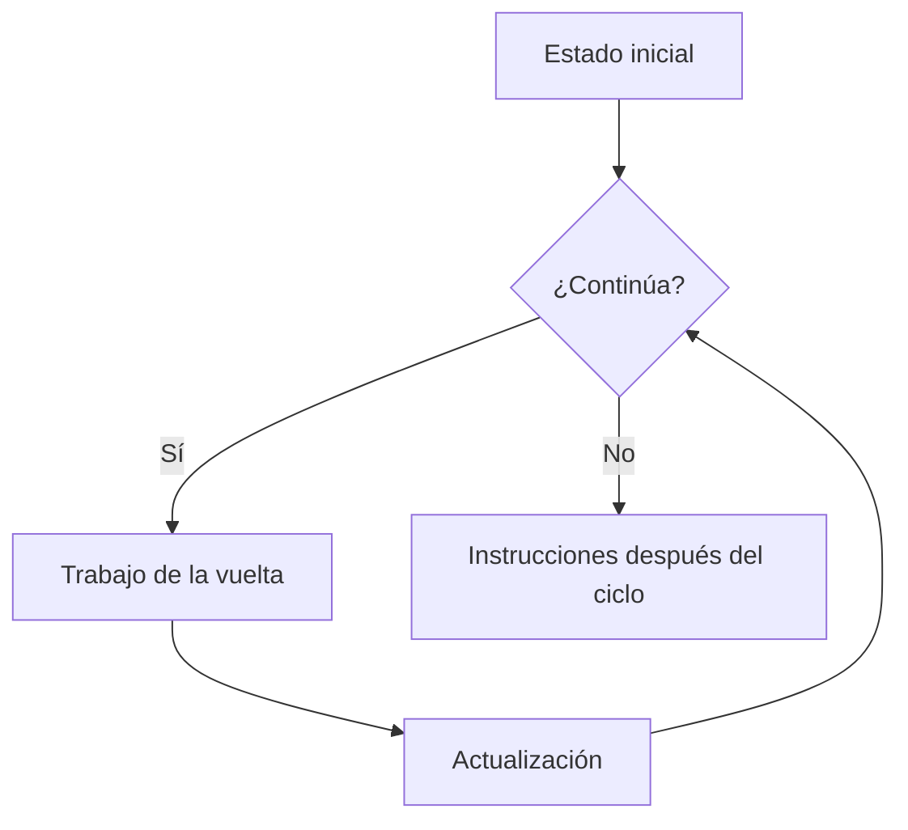

# Sesión 3 · Estructuras repetitivas

Aprenderás a repetir tareas con `while`, `do-while` y `for`, garantizar que un ciclo termine y controlar su flujo con `break` y `continue`. El bloque de labs tiene **un máximo de 40 minutos**; completa en casa lo pendiente para la siguiente clase.

## Preparación

1. Actualiza el material con `git pull` y trabaja en tu proyecto personal para resolver las actividades.
2. Usa IntelliJ IDEA con JDK 21 como referencia; las clases también son compatibles con Java 17.
3. Localiza la sesión en `src/01-fundamentos-java/sesion-03-estructuras-repetitivas/`. Si conservas esa organización, marca `demo/` y `labs/` como **Sources Root** y deja el `src/` general como carpeta organizadora.
4. Si copias los archivos directamente al `src/` de tu proyecto personal, marca ese `src/` como Sources Root. No conviertas las carpetas con guiones en paquetes Java.
5. Ejecuta cada clase desde su propio main. No usamos Scanner, arrays ni métodos auxiliares: cambia las variables iniciales para cada prueba.

## Las cuatro piezas de un ciclo

| Pieza | Pregunta | Ejemplo |
| --- | --- | --- |
| Inicio | ¿Con qué estado comienzo? | contador=1, suma=0 |
| Condición | ¿Cuándo continúo? | contador<=limite |
| Trabajo | ¿Qué hago en cada vuelta? | Imprimir y sumar contador |
| Progreso | ¿Qué cambia para poder terminar? | contador++ |

Un **contador** registra cuántas veces ocurre algo o qué posición se procesa. Un **acumulador** conserva un resultado parcial. `suma += contador` equivale a `suma = suma + contador`.

Este diagrama representa la evaluación previa de while. En do-while se ejecuta primero el cuerpo y se evalúa la condición al final.

## Qué ciclo elegir

| Ciclo | Condición | Cuándo usarlo |
| --- | --- | --- |
| while | Antes de cada vuelta; puede ejecutar cero veces | Repetición que depende de una condición |
| do-while | Después del cuerpo; ejecuta al menos una vez | Una primera ejecución necesaria |
| for | Antes de cada vuelta; reúne inicio, condición y avance | Rango o repeticiones con control conocido |

- **while:** inicializa el contador antes y actualízalo dentro del cuerpo. Si olvidas actualizarlo, puede no terminar.
- **do-while:** recuerda el punto y coma en `} while (condicion);`.
- **for:** el inicio se ejecuta una vez; después se comprueban condición, cuerpo y actualización. `numero <= limite` incluye el límite; `<` lo excluye.
- **break:** sale inmediatamente del ciclo actual; no termina toda la aplicación.
- **continue:** omite lo que falta de la vuelta. En for pasa a la actualización; en while puede saltarse una actualización colocada después y provocar una repetición sin fin.

No todos los problemas necesitan break o continue. Úsalos cuando expresen una regla concreta; una condición clara suele ser suficiente.

## Tres demos prácticas

| Demo | Qué observar | Prueba breve |
| --- | --- | --- |
| [S03DemoWhile.java](demo/S03DemoWhile.java) | Control de intentos y progreso | limite=3 muestra tres intentos; limite=0 no muestra ninguno |
| [S03DemoDoWhile.java](demo/S03DemoDoWhile.java) | Condición inicialmente falsa | Con contador=5 y limite=3, while no entra y do-while ejecuta una vez |
| [S03DemoFor.java](demo/S03DemoFor.java) | Acumular, omitir múltiplos de 3 y parar antes de 7 | Procesa 1, 2, 4 y 5; cantidad 4 y suma 12 |

Antes de Run, predice la primera y última vuelta. Si usas Debug, coloca un breakpoint en la condición o cuerpo y observa el contador antes y después de Step Over. No ejecutes un ciclo intencionalmente infinito para probarlo; analízalo primero. Si tu copia no termina, usa **Stop** y revisa condición y actualización.

## Cuatro retos integradores y entrega

Esta sesión usa cuatro problemas que combinan variables, operadores, decisiones y ciclos. El docente repartirá los retos en clase; no se espera completar los cuatro dentro del bloque de práctica de 40 minutos. Completa lo pendiente en casa según la asignación y tráelo para la siguiente clase.

| Reto | Sector | Enunciado |
| --- | --- | --- |
| 1 | Movilidad | [Sistema de tarifas de estacionamiento](labs/reto-01-estacionamiento/README.md) |
| 2 | Financiero | [Simulador de aprobación de créditos](labs/reto-02-creditos/README.md) |
| 3 | Manufactura | [Control de producción y calidad](labs/reto-03-calidad/README.md) |
| 4 | Gastronomía | [Sistema de pedidos para un restaurante](labs/reto-04-restaurante/README.md) |

Cada reto presenta el problema, decisiones previas, reglas y pruebas mínimas. Diseña tu propia solución con consola, Scanner, variables, operadores, decisiones y ciclos. No necesitas POO, arrays ni colecciones; la estructura y el ciclo pueden variar si respetan el comportamiento.

Scanner lee datos de la consola: importa `java.util.Scanner`, crea una instancia con `System.in` y usa nextInt/nextLong para enteros y nextDouble para medidas. En el reto de calidad usa punto decimal; puedes configurar `useLocale(java.util.Locale.US)` para mantener ese criterio. Cierra el Scanner al terminar la aplicación, después de todas las lecturas; cerrarlo también cierra System.in.

Publica los retos asignados en tu repositorio personal con un README breve de decisiones y pruebas. Comparte el enlace mediante Campus según indique el docente. Las extensiones son opcionales. No publiques archivos compilados ni configuración del IDE.
