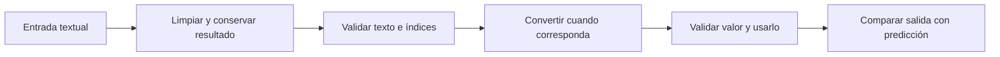

# Sesión 4 · Cadenas y conversiones

Aprenderás a limpiar, comparar y extraer texto, convertirlo en datos y explicar cuándo una conversión pierde información. Mantendremos **un máximo de 40 minutos de labs en clase**; el resto es para conceptos, demos y preguntas. Completa lo pendiente para la siguiente clase.

## Preparación

1. Actualiza el material con git pull y resuelve los labs en tu proyecto personal.
2. Usa IntelliJ IDEA y JDK 21 como referencia; las clases también compilan para Java 17. No usamos Maven ni Gradle.
3. Si conservas la organización bajo src por módulos y sesiones, marca demo/ y labs/ de esta sesión como Sources Root. No conviertas las carpetas con guiones en paquetes Java.
4. Si copias las clases directamente al src de un proyecto personal, marca ese src como Sources Root. Ejecuta cada archivo desde su propio main.

## Conceptos esenciales

| Necesidad | Herramienta | Precaución |
| --- | --- | --- |
| Quitar espacios externos | strip() | Guarda el resultado: String es inmutable. |
| Detectar texto en blanco | isBlank() | Las entradas de estos labs son no null. |
| Medir texto | length() | Cuenta unidades UTF-16; no siempre símbolos completos. |
| Obtener una posición | charAt(indice) | Índices desde 0 hasta length()-1; valida antes. |
| Extraer un intervalo | substring(inicio, fin) | Incluye inicio y excluye fin. |
| Comparar contenido | equals / equalsIgnoreCase | == entre String compara referencias. |
| Normalizar mayúsculas | toUpperCase(Locale.ROOT) | Guarda la nueva cadena; locale explícito estabiliza el resultado. |
| Texto a primitivo | Integer.parseInt / Double.parseDouble | Limpia antes; texto inválido puede producir NumberFormatException. |
| Texto a wrapper | Integer.valueOf | Produce Integer, no int. |
| Número a texto | String.valueOf | No confundir con un cast. |

Los métodos que transforman texto no cambian el contenido original: debes guardar su resultado o reasignar la variable. `String original="  Ana  "; original.strip();` deja original con espacios. Crear otra variable con original.strip() permite conservar ambas versiones.

## Conversiones numéricas y wrappers

- `int cantidad=10; double ampliada=cantidad;` es una ampliación permitida automáticamente. No todas las ampliaciones hacia punto flotante conservan precisión exacta.
- `(int) 7.9` produce 7 y `(int) -7.9` produce -7: el cast trunca hacia cero, no redondea.
- `Integer.parseInt("21")` interpreta texto y devuelve int. No puedes sustituirlo por `(int) "21"`.
- `Integer.valueOf("21")` devuelve Integer. El boxing representa un primitivo como wrapper; el unboxing recupera un primitivo de su wrapper. No necesitamos crear clases propias para observarlo.
- `Boolean.parseBoolean` acepta true sin distinguir mayúsculas; otros textos producen false. No es un validador estricto de respuestas.

## Tres demos

| Archivo | Qué observar |
| --- | --- |
| [S04DemoCadenas.java](demo/S04DemoCadenas.java) | Transformación sin guardar, original conservado, longitud, índice y substring |
| [S04DemoComparacion.java](demo/S04DemoComparacion.java) | Referencias distintas con contenido igual; comparación de una opción limpiada |
| [S04DemoConversiones.java](demo/S04DemoConversiones.java) | Cast positivo/negativo, parsing, wrapper, unboxing y texto |

Los ejemplos que producen un error de parsing quedan comentados. Si los activas para observar el diagnóstico, hazlo de uno en uno en tu copia y restáuralos después. El manejo formal de excepciones se verá posteriormente.

## Labs y entrega

Consulta [los pasos por TODO](labs/README.md).

| Minutos de práctica | Actividad |
| --- | --- |
| 0–10 | Lab 1: limpia y compara |
| 10–22 | Lab 2: extrae un identificador |
| 22–37 | Lab 3: convierte texto en datos |
| 37–40 | Revisar una salida y guardar avances |

Los labs 4 (casting y wrappers) y 5 (normaliza un registro), junto con lo pendiente, se terminan en casa. Trae los cinco para la siguiente clase y entrega el enlace de tu repositorio personal por Campus, según indique el docente.

No hay un catálogo de métodos que debas memorizar. Debes poder explicar qué limpias, qué comparas, qué conviertes y por qué guardas el resultado. Trabajamos con una estatura aproximada, no con dinero en double. No necesitas Scanner, arrays, StringBuilder ni try/catch para completar las actividades.
