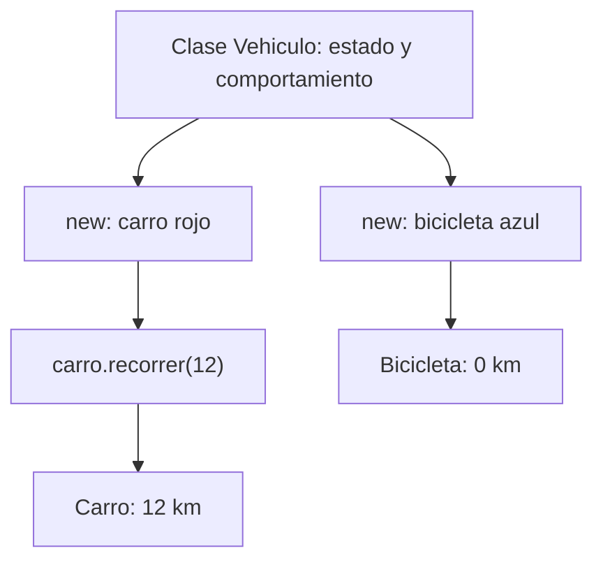

# Sesión 5 · Introducción a la programación orientada a objetos

Aprenderás a reunir datos y comportamientos en una clase, crear objetos con `new` y comprobar cómo cambia el estado de cada uno. Tendrás **60 minutos como máximo para los tres labs y su revisión**. Termina lo pendiente en casa para la siguiente clase.

## Preparación

Actualiza el material con `git pull` y copia los ejercicios a tu proyecto personal de IntelliJ IDEA. Usa JDK 21 o 17, sin Maven ni Gradle. Si conservas la estructura de este repositorio, marca `demo/` y `labs/` de esta sesión como **Sources Root**; las carpetas con guiones no son paquetes Java. Si copias los archivos directamente al `src` de un proyecto personal, usa ese `src` como raíz de código.

Cada actividad tiene una clase que representa el problema y otra que contiene `main`. Copia **los dos archivos** del lab a la misma raíz de código y ejecuta la clase `S05Lab...`.

## Conceptos esenciales

| Concepto | En el ejemplo de vehículos |
| --- | --- |
| Clase | `S05Demo01Vehiculo` define campos, constructor y métodos. |
| Objeto | El carro rojo creado con `new S05Demo01Vehiculo("Carro", "rojo")`. |
| Estado | Tipo, color y kilómetros de ese vehículo. |
| Constructor | Inicializa el tipo, el color y los kilómetros en cero. |
| `this` | El objeto cuyo constructor o método se está ejecutando. |
| Método de instancia | `carro.recorrer(12)` modifica ese carro. |
| Parámetro y argumento | `int kilometros` es el parámetro; `12` es el argumento recibido. |
| `void` | El método realiza una acción sin devolver un valor. |
| `return` | Entrega un resultado al código que llamó al método. |
| `static` | El conversor pertenece a la clase y se invoca sin crear un objeto. |

Los campos, constructores y métodos se declaran dentro de la clase y **fuera de `main`**. En `main` creas objetos, llamas métodos y compruebas resultados. Los campos privados se usan mediante los métodos del objeto; profundizaremos en encapsulamiento en la sesión 6.

Un constructor tiene el mismo nombre de la clase y **no declara tipo de retorno**. Escribir `public void S05Demo01Vehiculo(...)` crearía un método, no un constructor. Java genera un constructor predeterminado sin argumentos únicamente cuando no declaras ningún constructor. Un constructor sin argumentos escrito por ti es explícito. Los campos reciben valores iniciales por defecto; una variable local debe estar asignada antes de leerla.



Carro, moto, bicicleta y camión son valores del atributo `tipo` de objetos de una misma clase. La clase no se transforma en otra. Veremos herencia y polimorfismo en la sesión 7.

## Demos para trabajar con el docente

Los archivos con `01` pertenecen al primer demo y los de `02` al segundo. Primero lee la clase que define el comportamiento y después abre su archivo terminado en `Main`, que contiene el programa ejecutable.

| Orden | Archivo | Tema y acción |
| --- | --- | --- |
| 1 | `S05Demo01Vehiculo.java` | Explicar clase, campos, constructor, `this` y métodos. |
| 2 | `S05Demo01VehiculosMain.java` | Crear objetos con `new`, predecir recorridos y ejecutar en Debug. Terminar con las dos referencias al mismo carro. |
| 3 | `S05Demo02ConversorTemperatura.java` | Explicar parámetro, resultado con `return` y método `static`. |
| 4 | `S05Demo02ConversorTemperaturaMain.java` | Ejecutar el cálculo mediante el nombre de la clase y comparar con las llamadas sobre objetos. |

### 1. Vehículos cotidianos

Abre [S05Demo01Vehiculo.java](demo/S05Demo01Vehiculo.java) y ejecuta [S05Demo01VehiculosMain.java](demo/S05Demo01VehiculosMain.java).

1. Identifica los campos, el constructor y los dos métodos de instancia.
2. Antes de ejecutar, predice los kilómetros de cada vehículo: el carro recorre 12 y luego 3; la bicicleta recorre 4.
3. Coloca un breakpoint en la suma de `recorrer`. Ejecuta en Debug, usa Step Into al entrar desde una llamada y observa `this`, el parámetro y los kilómetros antes y después.
4. Observa la asignación `otroNombre = carro`: ambas referencias apuntan al mismo objeto. Al recorrer 2 kilómetros mediante `otroNombre`, el carro llega a 17. Solo `new` crea otra instancia en este ejemplo.

```text
Carro rojo: 15 km
Moto negra: 0 km
Bicicleta azul: 4 km
Camion blanco: 0 km
Despues de usar otra referencia:
Carro rojo: 17 km
```

El demo usa distancias positivas pequeñas. No es un simulador de tránsito ni valida todas las entradas posibles.

### 2. Conversor de temperatura

Abre [S05Demo02ConversorTemperatura.java](demo/S05Demo02ConversorTemperatura.java) y ejecuta [S05Demo02ConversorTemperaturaMain.java](demo/S05Demo02ConversorTemperaturaMain.java). Predice las dos salidas y observa que la llamada usa el nombre de la clase, sin `new`.

```text
0 C: 32.0 F
25 C: 77.0 F
```

`static` es útil aquí porque el cálculo no necesita estado de un objeto. Los campos de los libros, figuras y reservas de los labs pertenecen a cada instancia; no los declares `static`.

## Labs y entrega

Consulta [las instrucciones por TODO](labs/README.md). Los tres problemas son diferentes de los demos y combinan los conceptos de la sesión con decisiones y operaciones ya conocidas.

| Tiempo | Actividad |
| --- | --- |
| 0–15 min | Lab 1: préstamo de un libro |
| 15–35 min | Lab 2: medidas de un rectángulo |
| 35–55 min | Lab 3: reserva de una sala |
| 55–60 min | Comprobar una ejecución y guardar avances |

Entrega el enlace de tu repositorio personal en Campus según indique el docente. Completa lo pendiente para la siguiente clase. Debes poder señalar qué crea el constructor, qué objeto usa cada llamada y qué métodos devuelven resultados.
