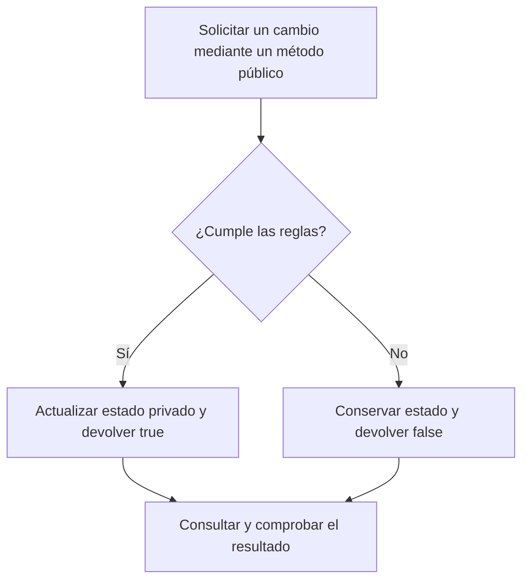

# Sesión 6 · Encapsulamiento

**Encapsular = reunir estado y comportamiento, restringir los cambios indebidos y ofrecer operaciones comprensibles y controladas.** Aprenderás a proteger las reglas de un objeto y distinguir entre consultar su estado y solicitar un cambio.

> Antes del encapsulamiento, cualquiera podía modificar el estado.  
> Después del encapsulamiento, el objeto decide cómo puede cambiar su estado.

En el ejemplo inicial, “cualquiera” significa otro código con acceso al campo público. Al hacerlo privado, ese código debe solicitar cambios mediante las operaciones que ofrece la billetera. El objeto comprueba sus reglas antes de aceptar cada solicitud.

## Preparación

Actualiza el material con `git pull` y trabaja en tu proyecto personal de IntelliJ IDEA con JDK 21 o 17, sin Maven ni Gradle. Si conservas la organización por sesiones, marca `demo/` y `labs/` de esta sesión como **Sources Root**. Las carpetas de módulo y sesión con guiones organizan el curso; no son paquetes Java.

Los demos 00 y 01 y cada lab tienen una clase de dominio y un archivo terminado en `Main` para ejecutar. Copia ambos archivos de cada actividad. En el demo 02 conserva las subcarpetas y sus declaraciones `package` bajo la raíz `demo/`; no marques cada paquete como otra raíz de código.

## Conceptos esenciales

| Concepto | Qué significa aquí |
| --- | --- |
| Estado | Los datos actuales del objeto: saldo, nombre o existencias. |
| Regla o invariante | Una condición que debe conservarse: el saldo nunca es negativo. |
| Campo privado | Otro código no puede asignarlo directamente desde una clase independiente. |
| Consulta | Devuelve información sin cambiar el objeto. |
| Operación controlada | Valida la solicitud; solo cambia el estado si se cumplen las reglas. |
| Interfaz pública | Los métodos que el objeto ofrece a quienes lo utilizan; no necesitamos declarar una `interface` Java. |
| Detalle interno | Un campo o método auxiliar que no necesita exponerse. |

Un getter como `getNombre()` permite consultar. Un setter convencional como `setNombre(...)` solicita asignar un valor; generarlo automáticamente no añade validaciones. No todos los campos necesitan ambos. `recargar` y `pagar` comunican la intención mejor que un `setSaldo` que permita asignar cualquier cantidad.

En estos ejemplos, `true` significa que se realizó la operación y `false` que se rechazó. Un rechazo conserva el estado previo. No es un error de compilación: el programa continúa. Intentar acceder directamente a un campo privado desde el Main sí produce un error de compilación.



## Modificadores de acceso

La tabla se refiere a miembros de una clase accesible y al código de clases independientes de estos ejemplos.

| Acceso | Dentro de la clase | Otra clase del mismo paquete | Otro paquete |
| --- | --- | --- | --- |
| `private` | Sí | No | No |
| Sin modificador: acceso de paquete | Sí | Sí | No |
| `protected` | Sí | Sí | Solo mediante las reglas de herencia aplicables |
| `public` | Sí | Sí | Sí |

El acceso de paquete se escribe **sin modificador**, no con `default`. `protected` tiene restricciones adicionales fuera del paquete; se practicará con herencia en la sesión 7. Las clases de nivel superior de esta sesión usan `public` o acceso de paquete, no `private` ni `protected`.

Un paquete se identifica mediante `package s06demo02.modelo;` y se organiza en carpetas correspondientes bajo una raíz de código. `private` controla acceso desde Java; no sustituye la autenticación o autorización de personas en una aplicación.

## Orden de los demos durante la explicación

Son **tres demos y siete archivos Java**. Lee primero la clase de dominio y ejecuta después su Main.

| Orden | Archivo | Momento de la explicación |
| --- | --- | --- |
| 1 | [S06Demo00Billetera.java](demo/S06Demo00Billetera.java) | Introducción: saldo privado y reglas de recarga y pago. |
| 2 | [S06Demo00BilleteraMain.java](demo/S06Demo00BilleteraMain.java) | Ejecutar solicitudes válidas e inválidas y observar el saldo. |
| 3 | [S06Demo01PerfilUsuario.java](demo/S06Demo01PerfilUsuario.java) | Consulta pública, cambio validado y método auxiliar privado. |
| 4 | [S06Demo01PerfilUsuarioMain.java](demo/S06Demo01PerfilUsuarioMain.java) | Ejecutar cambios de nombre y comprobar rechazos. |
| 5 | [FichaAcceso.java](demo/s06demo02/modelo/FichaAcceso.java) | Reconocer `package` y los distintos accesos. |
| 6 | [S06Demo02MismoPaqueteMain.java](demo/s06demo02/modelo/S06Demo02MismoPaqueteMain.java) | Ejecutar desde el mismo paquete. |
| 7 | [S06Demo02OtroPaqueteMain.java](demo/s06demo02/aplicacion/S06Demo02OtroPaqueteMain.java) | Ejecutar desde otro paquete y observar qué sigue siendo accesible. |

### Demo 00 · Billetera

Primero imagina que `saldo` fuera público: otra clase podría escribir `billetera.saldo = -5000L`. Con el campo privado, esa instrucción no compila desde el Main. Está comentada para conservar el ejemplo ejecutable.

La billetera nace en cero. Usa pesos enteros de tipo `long` y tiene un límite didáctico de 1000000 de pesos. Recargar requiere un valor positivo que quepa en el límite. Pagar exige un valor positivo que no supere el saldo: comprobar solo `valor <= saldo` permitiría que un pago negativo aumentara el saldo.

Antes de ejecutar cada solicitud, predice el saldo. Coloca un breakpoint en `pagar`, usa Step Into desde el Main y observa que el campo solo cambia después de validar. No llames de nuevo a una operación solo para imprimirla: cada llamada puede modificar el objeto.

```text
Saldo inicial: 0
Recargar 50000: true
Saldo: 50000
Pagar 18000: true
Saldo: 32000
Pagar 40000: false
Saldo: 32000
Pagar -5000: false
Saldo: 32000
Recargar 0: false
Saldo: 32000
```

El límite pertenece a esta billetera de ejemplo. No se ofrece `setSaldo`: los cambios pasan por `recargar` o `pagar`.

### Demo 01 · Perfil de usuario

El perfil comienza con `Sin nombre`. `cambiarNombre` rechaza `null` y texto en blanco; si acepta, conserva el texto sin espacios externos. `getNombre` consulta y `esNombreValido` es un detalle privado. La comprobación de `null` ocurre antes de llamar métodos de String.

En Debug, compara `nuevoNombre` con el campo `nombre` y comprueba que los rechazos mantienen `Ana`. `cambiarNombre` es una operación con intención; no sigue el nombre convencional de un setter `setNombre`.

```text
Nombre inicial: Sin nombre
Cambiar a Ana con espacios: true
Nombre: [Ana]
Cambiar a espacios: false
Nombre: [Ana]
Cambiar a null: false
Nombre: [Ana]
```

### Demo 02 · Mismo paquete y otro paquete

Ejecuta primero `s06demo02.modelo.S06Demo02MismoPaqueteMain`:

```text
Consulta publica: Dato privado
Acceso de paquete: Dato del paquete
```

Después ejecuta `s06demo02.aplicacion.S06Demo02OtroPaqueteMain`:

```text
Consulta publica: Dato privado
```

La consulta pública permite leer el dato privado desde ambos paquetes. El dato con acceso de paquete solo es accesible directamente desde el mismo paquete. Con el docente, activa **una sola línea prohibida** en tu copia para leer el diagnóstico de compilación y vuelve a comentarla antes de continuar. Estar en el mismo paquete tampoco autoriza acceder al campo privado.

## Labs y entrega

Consulta [los pasos por TODO](labs/README.md). Los labs usan termostato, inventario y pedido. Practicarás validación de rangos, disponibilidad y cambios de estado; no se repiten los perfiles ni las clases de acceso de los demos.

| Tiempo de práctica | Actividad |
| --- | --- |
| 0–15 min | Lab 1: termostato doméstico |
| 15–35 min | Lab 2: existencias de un almacén |
| 35–55 min | Lab 3: despacho de un pedido |
| 55–60 min | Comprobar resultados y guardar avances |

El máximo en clase es **una hora**. Completa lo pendiente en casa para la siguiente clase y entrega tu repositorio personal mediante Campus según indique el docente. Al cerrar, explica qué regla protege cada objeto y por qué un setter sin validación permitiría romperla.
