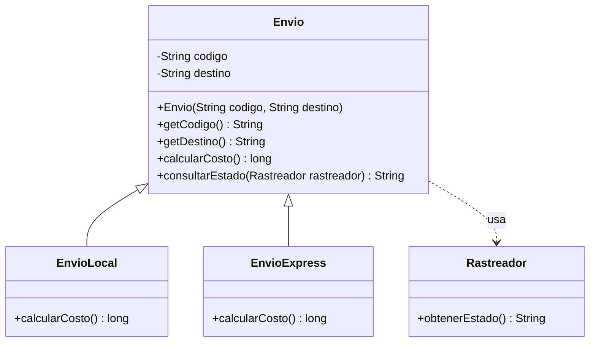
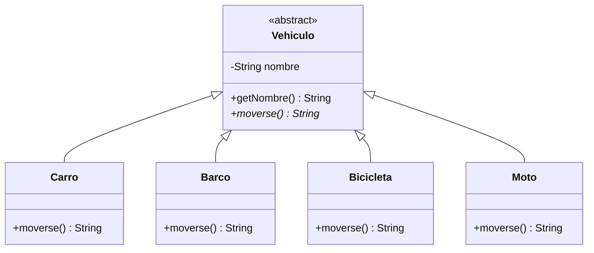

# Sesión 7 · Herencia y polimorfismo

Aprenderás a reconocer una relación **«es un»**, traducir un UML a clases y ejecutar comportamientos diferentes mediante un mismo tipo. También distinguirás una base abstracta de un contrato definido con una interfaz.

Los cinco demos se explican junto con cada tema. Después tendrás **55 minutos para cinco ejercicios breves y 5 minutos de revisión**. Las plantillas ya incluyen parte de la estructura; completa lo pendiente en casa para la siguiente clase.

## Preparación y carpetas

Actualiza el material con `git pull` y trabaja en tu proyecto personal de IntelliJ IDEA, con JDK 21 o 17, sin Maven ni Gradle. Si conservas la organización del repositorio, marca `demo/` y `labs/` de esta sesión como **Sources Root**. No marques cada paquete como otra raíz ni conviertas las carpetas con guiones en paquetes Java.

```text
sesion-07-herencia-polimorfismo/
├── README.md
├── demo/                         ← raíz de código
│   ├── s07demo00/
│   │   ├── base/                 ← Usuario.java
│   │   └── aplicacion/           ← Estudiante.java y Main
│   ├── s07demo01/                ← UML de envíos
│   ├── s07demo02/                ← polimorfismo
│   ├── s07demo03/                ← clases abstractas
│   └── s07demo04/                ← interfaces
└── labs/                         ← raíz de código
    ├── README.md
    ├── s07lab00/
    ├── s07lab01/
    ├── s07lab02/
    ├── s07lab03/
    └── s07lab04/
```

Si copias los ejercicios al `src` de un proyecto personal, conserva allí los paquetes `s07lab00` a `s07lab04`. Por ejemplo, `src/s07lab00/Lavadora.java` declara `package s07lab00;`. Copia todos los archivos de cada ejercicio. Para el demo 02 también necesitas el paquete del demo 01, porque reutiliza sus envíos.

## Conceptos que debes distinguir

| Concepto | Qué expresa |
| --- | --- |
| `extends` | Una clase especializa a otra: un estudiante es un usuario. |
| `this.campo` | El campo del objeto actual, diferenciado del parámetro. |
| `super(...)` | Invoca un constructor accesible de la superclase. Los constructores no se heredan. |
| `super.metodo()` | Ejecuta la implementación de la superclase sobre el mismo objeto. |
| `private` | El campo se gestiona dentro de la clase que lo declara; no es accesible directamente desde una subclase independiente. |
| `protected` | Accesible en el mismo paquete y, con restricciones, desde subclases de otros paquetes. |
| Sobrescritura | La subclase implementa de nuevo un método de instancia compatible; `@Override` comprueba la intención. |
| Polimorfismo | Una referencia base llama al método sobrescrito del objeto concreto en ejecución. |
| Clase abstracta | Base que no se instancia directamente; puede compartir estado, constructor y métodos concretos. |
| Interfaz | Define un tipo y un contrato que varias clases pueden implementar. |

Para Java 17 y 21, `super(...)` va primero en el constructor. La superclase inicializa su parte del estado y después se completa la subclase. No hay un segundo objeto padre separado. Usa Debug y Step Into para seguir esa secuencia.

La **sobrecarga** cambia la lista de parámetros, como `sumar(int, int)` y `sumar(int, int, int)`; el compilador selecciona según los argumentos. La **sobrescritura** mantiene una firma compatible y permite elegir la implementación del objeto en ejecución. Cambiar solo el retorno no sobrecarga. Los métodos `static` no usan ese mismo despacho dinámico.

## Demo 00 · Herencia, this, super y accesos

Lee y ejecuta en este orden:

1. [Usuario.java](demo/s07demo00/base/Usuario.java): nombre privado, constructor, consulta pública y descripción protegida.
2. [Estudiante.java](demo/s07demo00/aplicacion/Estudiante.java): `extends Usuario`, `super(nombre)`, `this.curso` y uso de `describirIdentidad()`.
3. [S07Demo00HerenciaMain.java](demo/s07demo00/aplicacion/S07Demo00HerenciaMain.java): crea un estudiante y muestra su información. **Este es el archivo ejecutable.**

Coloca un breakpoint en el constructor de `Estudiante` y sigue la llamada al constructor de `Usuario`. Después distingue el método público heredado `getNombre()` del método propio `mostrarFicha()`.

```text
Nombre heredado mediante consulta: Ana
Usuario: Ana - curso: Java
```

La subclase puede usar la descripción protegida, pero no acceder directamente al campo privado `nombre`. El Main está fuera del paquete de `Usuario` y no es subclase: tampoco puede llamar a esa descripción protegida. Las líneas prohibidas están comentadas. Activa una a la vez en tu copia, observa el diagnóstico y vuelve a comentarla antes de continuar.

`protected` no significa «solo los hijos»: también permite acceso en el paquete de la clase que lo declara. Fuera del paquete, una subclase no obtiene acceso mediante cualquier referencia de tipo padre.

## Demo 01 · Convertir el UML de envíos a clases

En UML, `-` significa privado, `+` público y `#` protegido. La generalización apunta a la superclase; la flecha discontinua indica una dependencia de uso.



El diagrama implementado adapta el costo `double` de la imagen a **`long` en pesos enteros**. Añadimos constructores, consultas, tarifas y `consultarEstado` para ejecutar el modelo. Esas decisiones no estaban detalladas en la imagen.

Orden de lectura:

1. [Envio.java](demo/s07demo01/Envio.java): estado común y costo estándar de 10000 pesos.
2. [EnvioLocal.java](demo/s07demo01/EnvioLocal.java) y [EnvioExpress.java](demo/s07demo01/EnvioExpress.java): local cuesta 8000; express usa `super.calcularCosto()` y suma 5000.
3. [Rastreador.java](demo/s07demo01/Rastreador.java): devuelve un estado fijo de simulación.
4. Ejecuta [S07Demo01UmlMain.java](demo/s07demo01/S07Demo01UmlMain.java).

```text
L-01 - Bucaramanga - costo: 8000 pesos
Estado local: EN TRANSITO
E-01 - Bogota - costo: 15000 pesos
Estado express: EN TRANSITO
```

`Envio` recibe y usa el rastreador como parámetro, sin guardarlo. Es una dependencia: el rastreador no es una clase hija del envío y la flecha no establece composición. No se consulta una plataforma real de seguimiento.

## Demo 02 · Un tipo, comportamientos diferentes

Lee [Animal.java](demo/s07demo02/Animal.java), [Perro.java](demo/s07demo02/Perro.java) y [Gato.java](demo/s07demo02/Gato.java). Después abre y ejecuta [S07Demo02PolimorfismoMain.java](demo/s07demo02/S07Demo02PolimorfismoMain.java).

El Main primero reutiliza los envíos: `mostrarCosto(Envio envio)` recibe una variante local o express sin consultar su tipo. Después `escuchar(Animal animal)` recibe un perro o un gato. Ambas funciones se mantienen iguales para sus dos llamadas.

```text
Costo: 8000 pesos
Costo: 15000 pesos
Guau
Miau
```

Antes de ejecutar, señala el tipo de cada referencia y la clase del objeto creado con `new`. Usa Step Into desde `mostrarCosto` o `escuchar`: la implementación ejecutada depende del objeto concreto. La referencia base no transforma al perro en otro animal ni cambia la clase del objeto. No se necesitan casts, listas ni condicionales por tipo.

## Demo 03 · Qué se comparte y qué queda abstracto

Lee [Poliza.java](demo/s07demo03/Poliza.java): número, vigencia de 12 meses y consultas tienen implementación; `prima()` queda abstracto. Luego revisa [PolizaHogar.java](demo/s07demo03/PolizaHogar.java) y [PolizaAuto.java](demo/s07demo03/PolizaAuto.java). Ejecuta [S07Demo03AbstractasMain.java](demo/s07demo03/S07Demo03AbstractasMain.java).

```text
H-01 - vigencia: 12 meses - prima anual: 240000 pesos
A-01 - vigencia: 12 meses - prima anual: 600000 pesos
```

Las primas son tarifas didácticas, no cotizaciones reales. Los datos de construcción del demo son válidos y fijos. Cada subclase respeta el contrato: conserva el número y la vigencia y devuelve una prima anual no negativa. No debería romperlo devolviendo una prima negativa o rechazando sin motivo una operación exigida por la base.

La línea comentada `new Poliza("P-01")` permite observar que no puedes instanciar directamente esa clase. Su constructor sí se ejecuta al crear una póliza concreta. Un método abstracto termina en `;`, sin cuerpo; una clase abstracta también puede tener métodos concretos e incluso no declarar métodos abstractos.

### Otra forma de reconocer la idea: vehículos

Este segundo esquema es conceptual; no añade otro demo ejecutable. Todos tienen nombre y se desplazan, pero cada variante decide cómo hacerlo. Placa y motor no son requisitos universales de todos estos vehículos.



Carro y moto circulan por carretera; barco navega; bicicleta avanza al pedalear. La base reúne lo común sin exigir a una bicicleta encender un motor.

## Demo 04 · Contrato mediante una interfaz

Lee [Notificable.java](demo/s07demo04/Notificable.java), [AlertaEmail.java](demo/s07demo04/AlertaEmail.java) y [AlertaSMS.java](demo/s07demo04/AlertaSMS.java). Ejecuta [S07Demo04InterfacesMain.java](demo/s07demo04/S07Demo04InterfacesMain.java).

```text
EMAIL: Clase de Java a las 8
SMS: Clase de Java a las 8
```

`avisar(Notificable canal, String mensaje)` usa el contrato y llama a `notificar`. Cada clase lo implementa con `implements` y un método público con `@Override`. Solo se imprime en consola; no se envían correos ni SMS reales.

| Elige | Cuando necesitas |
| --- | --- |
| Clase concreta | Crear objetos con comportamiento ya definido. |
| Clase abstracta + `extends` | Compartir estado y comportamiento de una familia, dejando variaciones obligatorias. |
| Interfaz + `implements` | Exigir una capacidad común a distintas implementaciones. |
| Colaboración por parámetro | Usar otro objeto para resolver una responsabilidad, como el rastreador. |

Java permite extender una clase e implementar varias interfaces. Una interfaz es un tipo y un contrato, no una clase «completamente abstracta»; también admite otras formas de métodos que no necesitamos aquí. Una implementación no puede reducir la visibilidad pública exigida por el contrato.

## Práctica y entrega

Sigue [los pasos por TODO de los labs](labs/README.md). Cada ejercicio usa un contexto diferente al de los demos.

| Minutos | Ejercicio |
| --- | --- |
| 0–8 | Lab 00: herencia en una lavadora |
| 8–18 | Lab 01: UML de trámites |
| 18–28 | Lab 02: polimorfismo de servicios técnicos |
| 28–40 | Lab 03: planes de entrenamiento abstractos |
| 40–55 | Lab 04: interfaz de exportación |
| 55–60 | Comparar resultados y guardar avances |

Completa lo pendiente para la siguiente clase y entrega el enlace de tu repositorio personal mediante Campus según indique el docente. Debes poder explicar por qué existe cada relación y qué implementación se ejecuta en cada llamada.
