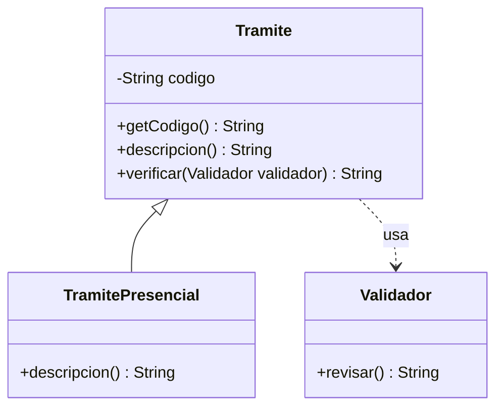

# Laboratorios de la sesión 7

Cinco ejercicios pequeños, uno por tema: **8 + 10 + 10 + 12 + 15 minutos**, más 5 de revisión. La estructura está parcialmente preparada. Completa lo pendiente en casa para la siguiente clase.

## Antes de escribir código

Copia las carpetas `s07lab00` a `s07lab04` a una raíz de código de tu proyecto personal. Si usas `src`, por ejemplo, `Lavadora.java` debe quedar en `src/s07lab00/` y conservar `package s07lab00;`. Copia todos los archivos de cada lab y ejecuta su archivo terminado en `Main`.

Resuelve cada TODO donde está ubicado: declaración de clase, constructor, método o Main. Conserva nombres y firmas. Reemplaza los retornos provisionales sin dejar instrucciones inalcanzables. Las plantillas compilan inicialmente, pero aún no producen los resultados esperados. Al añadir una relación o un método abstracto debes completar los cambios asociados antes de volver a compilar.

Los datos proporcionados son válidos. No necesitas Scanner, arreglos, colecciones, excepciones ni escribir archivos. No sustituyas las llamadas por salidas escritas literalmente: imprime el resultado de los métodos del objeto.

## Lab 00 · Herencia de un electrodoméstico · 8 minutos

Una lavadora **es un electrodoméstico**. Debe conservar la marca definida en la base y añadir su capacidad; no debe declarar otra marca.

**Archivos:** [Electrodomestico.java](s07lab00/Electrodomestico.java), [Lavadora.java](s07lab00/Lavadora.java) y [S07Lab00HerenciaMain.java](s07lab00/S07Lab00HerenciaMain.java).

### Pasos para completar la actividad

1. Lee `Electrodomestico`: el constructor guarda la marca privada, `getMarca()` la consulta y `describirMarca()` devuelve la marca con acceso protegido. No modifiques esta clase.
2. En `Lavadora`, **TODO 1: Hacer que Lavadora herede de Electrodomestico.** Añade `extends Electrodomestico` después del nombre de la clase. Desde ese momento el constructor debe inicializar también la base: completa el siguiente paso antes de ejecutar.
3. En su constructor, **TODO 2: Invocar super(marca) primero y guardar capacidadKg con this.** La primera instrucción debe invocar el constructor de la base con el parámetro `marca`. Después asigna el parámetro de capacidad a `this.capacidadKg`. No escribas `this.marca`: el campo de la base es privado.
4. En `ficha()`, **TODO 3: Devolver la ficha usando describirMarca() y capacidadKg.** Sustituye el retorno vacío por una concatenación: texto `"Lavadora "`, resultado de `describirMarca()`, texto `" - capacidad: "`, campo de capacidad y texto `" kg"`. No imprimas dentro de `ficha`; devuelve el String.
5. Ejecuta el Main preparado: construye `new Lavadora("Limpia", 8)` e imprime su ficha. Comprueba la línea esperada y señala qué instrucción inicializa la marca y cuál la capacidad.

```text
Lavadora Limpia - capacidad: 8 kg
```

## Lab 01 · Del UML a clases de trámites · 10 minutos

Una oficina registra trámites y utiliza un validador para revisar documentos. El resultado del validador es una simulación fija. El trámite presencial especializa la descripción de la base.



**Archivos:** [Tramite.java](s07lab01/Tramite.java), [TramitePresencial.java](s07lab01/TramitePresencial.java), [Validador.java](s07lab01/Validador.java) y [S07Lab01UmlMain.java](s07lab01/S07Lab01UmlMain.java).

### Pasos para completar la actividad

1. Compara el UML con las clases. `extends Tramite` y `super(codigo)` ya están preparados en `TramitePresencial`; identifica la flecha que representan. `Validador` no hereda de `Tramite`.
2. En `Tramite`, **TODO 1: Hacer privado el campo codigo sin cambiar su nombre ni tipo.** Añade `private` a su declaración y conserva `final`. El constructor y `getCodigo()` ya están completos. El símbolo `-` del diagrama corresponde a este cambio.
3. En `verificar`, **TODO 2: Devolver el resultado de revisar() del validador recibido.** Usa el parámetro `validador` para llamar a `revisar()` y devuelve lo que entrega. No crees otro validador dentro del método ni guardes uno como campo: se solicita un uso puntual.
4. En `TramitePresencial`, **TODO 3: Agregar @Override y devolver la descripcion usando getCodigo().** Coloca la anotación justo encima del método y sustituye el retorno vacío por `"Tramite presencial: "` concatenado con la consulta heredada. No accedas directamente al campo privado.
5. Ejecuta el Main preparado con código `T-01`. Comprueba las dos líneas. Explica cuál relación es «es un» y cuál es «usa»; no necesitas dibujar otro UML.

```text
Tramite presencial: T-01
DOCUMENTOS REVISADOS
```

## Lab 02 · Duración de servicios técnicos · 10 minutos

Un servicio general dura 15 minutos; una revisión dura 30 y una instalación, 45. Un mismo método cliente debe mostrar la duración de cualquiera de esas variantes.

**Archivos:** [ServicioTecnico.java](s07lab02/ServicioTecnico.java), [RevisionEquipo.java](s07lab02/RevisionEquipo.java), [InstalacionPrograma.java](s07lab02/InstalacionPrograma.java) y [S07Lab02PolimorfismoMain.java](s07lab02/S07Lab02PolimorfismoMain.java).

### Pasos para completar la actividad

1. Lee la base `ServicioTecnico` y observa que las dos variantes ya usan `extends`. No modifiques el método de la base para resolver todas las duraciones con condicionales.
2. En `RevisionEquipo`, **TODO 1: Agregar @Override y devolver 30 minutos en duracionMinutos().** Coloca la anotación encima del método y cambia su retorno provisional a 30.
3. En `InstalacionPrograma`, **TODO 2: Agregar @Override y devolver 45 minutos en duracionMinutos().** Conserva la misma firma del método de la base; cambia la implementación a 45.
4. En `mostrarDuracion` del Main, **TODO 3: Imprimir la duracion consultando servicio.duracionMinutos().** Escribe un `System.out.println` con `"Duracion: "`, la llamada sobre el parámetro `servicio` y `" min"`. No compruebes si el objeto es una revisión o una instalación.
5. En `main`, **TODO 4: Reemplazar null por objetos RevisionEquipo e InstalacionPrograma.** Conserva las variables de tipo `ServicioTecnico`; sustituye cada `null` por el `new` correspondiente sin argumentos. Las dos llamadas a `mostrarDuracion` ya están escritas. `null` era solo un marcador; no ejecutes el método completado hasta reemplazar ambos.
6. Predice y ejecuta las dos llamadas. Para una comprobación con Debug, entra desde `servicio.duracionMinutos()` y observa que Java selecciona una implementación distinta en cada llamada aunque el parámetro tenga siempre el mismo tipo.

```text
Duracion: 30 min
Duracion: 45 min
```

## Lab 03 · Planes de entrenamiento abstractos · 12 minutos

Todo plan comparte un nombre, pero la base no define una duración general. Cada variante debe aportar su duración. Los números solo ilustran el contrato; no son una recomendación de ejercicio físico.

**Archivos:** [PlanEntrenamiento.java](s07lab03/PlanEntrenamiento.java), [PlanFuerza.java](s07lab03/PlanFuerza.java), [PlanCardio.java](s07lab03/PlanCardio.java) y [S07Lab03AbstractasMain.java](s07lab03/S07Lab03AbstractasMain.java).

### Pasos para completar la actividad

1. En la declaración de la base, **TODO 1: Declarar PlanEntrenamiento como clase abstracta.** Añade `abstract` entre `public` y `class`. Conserva el constructor y `getNombre()`: ya implementan lo compartido.
2. Al final de la base, **TODO 2: Declarar public abstract int duracionMinutos() sin cuerpo.** Escribe la declaración y termina en `;`, sin llaves ni `return`. Esta obligación será completada por las variantes concretas.
3. En `PlanFuerza`, **TODO 3: Agregar @Override y devolver 3 * 8 minutos.** La clase ya inicializa el nombre `Fuerza` mediante `super`. Añade la anotación y reemplaza el retorno provisional por el producto de 3 bloques de 8 minutos.
4. En `PlanCardio`, **TODO 4: Agregar @Override y devolver 2 * 15 minutos.** Completa el método con la duración de dos bloques de 15. No escribas ciclos: solo se necesita la multiplicación.
5. En `mostrarPlan` del Main, **TODO 5: Imprimir nombre y duracion mediante los metodos del plan.** Escribe un `println` que una `plan.getNombre()`, `": "`, `plan.duracionMinutos()` y `" min"`. Los dos objetos y las llamadas a este cliente ya están preparados.
6. Ejecuta y compara las dos líneas. Señala qué método es concreto en la base y cuál quedó abstracto. Explica por qué `new PlanFuerza()` es válido y `new PlanEntrenamiento("General")` no lo sería; no dejes esa instrucción inválida en el programa.

```text
Fuerza: 24 min
Cardio: 30 min
```

## Lab 04 · Una interfaz para exportar un resumen · 15 minutos

Necesitamos representar los mismos datos como texto y como una línea separada por coma. El cliente debe pedir la representación mediante un contrato común y después imprimirla.

**Archivos:** [Exportable.java](s07lab04/Exportable.java), [ResumenTexto.java](s07lab04/ResumenTexto.java), [ResumenCsv.java](s07lab04/ResumenCsv.java) y [S07Lab04InterfacesMain.java](s07lab04/S07Lab04InterfacesMain.java).

### Pasos para completar la actividad

1. En `Exportable`, **TODO 1: Declarar String exportar(String titulo, int cantidad) sin cuerpo.** Escribe la firma dentro de la interfaz y termina en `;`. No escribas allí las concatenaciones de las variantes.
2. En `ResumenTexto`, **TODO 2: Implementar Exportable y completar exportar con @Override.** Añade `implements Exportable` a la declaración de clase y `@Override` encima del método. Devuelve `titulo`, seguido de `": "` y `cantidad`. Conserva el método público y su retorno String; no imprimas dentro de él.
3. En `ResumenCsv`, **TODO 3: Implementar Exportable y completar exportar con @Override.** Declara la misma relación y anotación, pero devuelve `titulo`, una coma `","` y `cantidad`, sin espacios adicionales. Usaremos solo un título simple sin comas, comillas ni saltos; no estás creando un exportador CSV general.
4. En `mostrarExportacion` del Main, **TODO 4: Imprimir formato.exportar con Asistencia y 12.** Escribe un `println` cuyo contenido sea el resultado de llamar a `formato.exportar` con `"Asistencia"` y `12`. La función solo conoce `Exportable`; no debe preguntar por la clase concreta.
5. En `main`, **TODO 5: Llamar al mismo cliente con un ResumenTexto y un ResumenCsv.** Escribe dos llamadas a `mostrarExportacion`, primero pasando `new ResumenTexto()` y después `new ResumenCsv()`. Completa antes los `implements` para que ambos objetos sean aceptados por el parámetro de interfaz.
6. Ejecuta y compara las dos líneas. Identifica quién construye el String y quién lo imprime. No escribas archivos, envíes notificaciones ni instales librerías.

```text
Asistencia: 12
Asistencia,12
```

Al cerrar la práctica, comprueba una salida y guarda los avances. Termina lo pendiente para la próxima clase y entrega tu repositorio personal según indique el docente.
