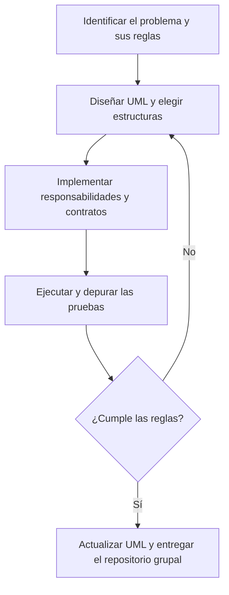

# Sesión 8 · Arreglos, listas y clases genéricas

En clase trabajaremos con **seis demos numerados del 00 al 05**. Los retos integradores corresponden a los labs para casa; no sustituyen las demostraciones de los temas.

Trabajaremos con **cinco retos alternativos para desarrollar en grupo y en casa**. El docente asignará el reto de cada grupo, su conformación y la fecha de entrega; no se exige que cada grupo resuelva los cinco.

Integra lo aprendido en las primeras ocho sesiones: variables, operadores, decisiones, ciclos, cadenas y conversiones; clases, objetos y encapsulamiento; herencia, polimorfismo, clases abstractas e interfaces; arreglos, listas y una clase genérica propia.

## Demos de clase: orden de presentación

Marca `demo/` de esta sesión como **Sources Root** y conserva sus paquetes `s08demo00` a `s08demo05`. Si copias los ejemplos a otro proyecto, conserva estos paquetes bajo su `src`. No marques cada paquete como una raíz independiente. El demo 05 reutiliza `Caja` del demo 03: copia también ese paquete.

| Orden | Tema | Archivo que debes ejecutar |
| --- | --- | --- |
| 00 | Arreglos: tamaño fijo, índices, ciclos y copia ordenada | [S08Demo00ArreglosMain.java](demo/s08demo00/S08Demo00ArreglosMain.java) |
| 01 | `List` y `ArrayList`: agregar, consultar, cambiar y eliminar | [S08Demo01ArrayListMain.java](demo/s08demo01/S08Demo01ArrayListMain.java) |
| 02 | `LinkedList`: entradas y salidas por los extremos | [S08Demo02LinkedListMain.java](demo/s08demo02/S08Demo02LinkedListMain.java) |
| 03 | Clase genérica con `<T>`: un contenido de tipo definido | [S08Demo03GenericoTMain.java](demo/s08demo03/S08Demo03GenericoTMain.java) |
| 04 | Clase genérica con `<E>`: elementos de un grupo tipado | [S08Demo04GenericoEMain.java](demo/s08demo04/S08Demo04GenericoEMain.java) |
| 05 | Diamante `<>`: inferir el argumento de tipo | [S08Demo05DiamanteMain.java](demo/s08demo05/S08Demo05DiamanteMain.java) |

### Demo 00 · Arreglos

1. Declara y crea el arreglo de cuatro tiempos de viaje. Distingue `int[] tiempos` de `new int[4]`: la longitud se fija al crear el arreglo, no al declarar la variable.
2. Predice qué representan los índices 0 y 3. Recorre con `for` para mostrar posiciones y acumular; luego observa el `for-each` que busca el mayor sin necesitar índices.
3. Coloca un breakpoint en la suma y observa el índice, el valor actual y el total. El promedio convierte el total a `double` antes de dividir.
4. El índice 4 es rechazado antes de acceder. La línea que provocaría el error queda comentada.
5. Compara original y copia: `Arrays.sort` modifica el arreglo que recibe. Ordenar la copia conserva el orden de los viajes en el original.

```text
Longitud: 4
Primer tiempo: 12
Viaje 1: 12 min
Viaje 2: 18 min
Viaje 3: 10 min
Viaje 4: 20 min
Total: 60 min
Promedio: 15.0 min
Mayor: 20 min
Indice rechazado: 4
Original: [12, 18, 10, 20]
Copia ordenada: [10, 12, 18, 20]
```

Para un arreglo se usa `length`; para un String, `length()`; para una lista, `size()`. Un arreglo existente no crece; la variable sí puede referenciar después otro arreglo.

### Demo 01 · List y ArrayList

1. Lee `List<String> compras = new ArrayList<>()`: el contrato es List y la implementación es ArrayList. La interfaz no se instancia directamente.
2. Observa que `add` admite repetidos. `get` consulta y `set` reemplaza una posición existente sin aumentar la cantidad.
3. Sigue las eliminaciones: `remove("Pan")` quita la primera coincidencia; `remove(0)` quita por índice. Los elementos posteriores cambian de posición.
4. Compara las dos sobrecargas cuando los elementos son Integer: `remove(1)` quita la posición 1; `remove(Integer.valueOf(10))` quita el valor 10. El recorrido no elimina elementos durante un for-each.
5. Después de `clear`, la lista está vacía. No actives `get(0)` sin comprobar antes que exista la posición.

```text
Vacia: true
Compras: [Pan, Leche, Pan]
Cantidad: 3
Primera: Pan
Tras set: [Pan, Fruta, Pan]
Contiene Pan: true
Tras quitar primer Pan: [Fruta, Pan]
Tras quitar indice 0: [Pan]
Pendiente: Pan
Quitar indice 1: [10, 10]
Quitar valor 10: [10]
Vacia al terminar: true
```

### Demo 02 · LinkedList

1. Observa `addLast` y `addFirst`: una visita se agrega al final y otra al principio. `peekFirst` consulta sin retirar; `pollFirst` consulta y retira.
2. Predice quién se atiende primero: Marta. Después compara la fila antes y después de la atención.
3. `List<String> comoLista = visitas` referencia la misma lista, no una copia. Modificarla mediante `set` se ve desde `visitas`.
4. Retira las visitas restantes. `peekFirst` y `pollFirst` devuelven `null` cuando está vacía; estas operaciones concretas permiten comprobar el vacío sin provocar un error. El ejemplo solo agrega nombres no nulos.

```text
Fila: [Marta, Ana, Luis]
Siguiente: Marta
Atendida: Marta
Pendientes: [Ana, Luis]
Actualizada como List: [Luisa, Luis]
Por atender: Luisa
Por atender: Luis
Consulta vacia: null
Retiro vacio: null
```

LinkedList no es siempre más rápida para insertar: localizar una posición también puede exigir recorrer nodos. ArrayList permite acceso posicional directo; LinkedList resulta útil para ilustrar operaciones en extremos. No cambies todas las listas de los retos a LinkedList por este ejemplo.

### Demo 03 · Genéricos con T

Lee primero [Caja.java](demo/s08demo03/Caja.java): declara `Caja<T>`, almacena `T` y devuelve `T`. Después ejecuta el Main con una caja Integer y otra String. Las cajas se crean con contenido válido no nulo; `guardar` rechaza null y conserva el contenido anterior.

```text
Numero: 42
Texto: Hola, Java
Guardar otro numero: true
Numero actual: 7
Guardar null: false
Texto conservado: Hola, Java
```

`T` suele recordar **tipo**. No significa «cualquier tipo puede entrar en cualquier momento»: en `Caja<Integer>` las operaciones usan Integer. No se necesitan casts al recuperar el contenido. `int valor = numero.obtener()` usa unboxing de Integer. `Caja<int>` no es válido; se usa el wrapper Integer.

La línea comentada `numero.guardar("siete")` no compila. Actívala solo en una copia para leer el diagnóstico y vuelve a comentarla antes de continuar.

### Demo 04 · Genéricos con E

Lee primero [Grupo.java](demo/s08demo04/Grupo.java). `Grupo<E>` almacena una `List<E>`, recibe un `E` al agregar y devuelve un `E` al consultar. Ejecuta después el Main con nombres y edades.

```text
Nombre: Ana
Nombre: Luis
Primera edad: 20
Agregar null: false
Cantidad de nombres: 2
Indice inexistente: null
```

`E` suele recordar **elemento**. T y E son nombres convencionales de parámetros de tipo: **Java los trata con la misma función**, no son dos mecanismos distintos ni palabras reservadas. `Grupo<String>` no admite un Integer porque E quedó concretado como String.

Este grupo rechaza elementos nulos. Una consulta fuera de rango devuelve null; el cliente debe comprobar ese resultado antes de usarlo. No conviertas automáticamente un Integer nulo a int. La lista interna sigue privada: no se entrega un getter que permita modificarla sin pasar por las operaciones del grupo.

### Demo 05 · Diamante <>

Compara estas declaraciones del Main:

```java
List<String> explicita = new ArrayList<String>();
List<String> inferida = new ArrayList<>();
Caja<String> saludo = new Caja<>("Hola");
```

```text
Tipo repetido: [Java]
Con diamante: [Java]
Mismo contenido: true
Caja con diamante: Hola
```

El diamante evita repetir los argumentos de tipo que el compilador puede inferir del contexto. **No elimina el tipo ni hace dinámica la lista.** Intentar agregar 42 a la lista String sigue siendo un error. `new ArrayList()` sin argumentos de tipo es un uso raw; no equivale a `new ArrayList<>()`.

Conecta los tres símbolos: `<T>` y `<E>` declaran parámetros al definir una clase; `<String>` elige un tipo al utilizarla; `<>` permite inferirlo al construir la instancia. No necesitas convertir esta comparación en otro lab.

## Elige el reto asignado

| Reto | Problema principal | Qué deben comprobar |
| --- | --- | --- |
| [1 · Feria de talleres](labs/reto-01-feria-talleres/README.md) | Inscripciones y duraciones según modalidad | Cupos válidos y rechazos sin alterar inscritos. |
| [2 · Refugio y adopciones](labs/reto-02-refugio-adopciones/README.md) | Disponibilidad y cuidado por especie | No adoptar dos veces ni borrar el historial. |
| [3 · Brigada de reciclaje](labs/reto-03-brigada-reciclaje/README.md) | Entregas, puntos y correcciones | Totales actuales que excluyan registros retirados. |
| [4 · Torneo escolar](labs/reto-04-torneo-escolar/README.md) | Resultados y puntuación por categoría | Límite de partidos, líder y empates bien definidos. |
| [5 · Huerta comunitaria](labs/reto-05-huerta-comunitaria/README.md) | Necesidad de riego y control de tanque | Descontar agua solo si alcanza para todas las parcelas. |

Cada reto tiene su propio README con reglas, datos, pasos y resultados de prueba. No hay plantilla TODO: el grupo debe proponer y justificar su diseño.

## Primero analizar y modelar, después programar

1. **Identifiquen el problema en el README del grupo:** usuario, necesidad, objetivo, entradas, salidas, reglas y alcance.
2. **Diseñen el UML de clases antes del código.** Incluyan atributos, métodos, tipos, visibilidad, herencia, interfaz, relaciones de uso y clase genérica. Pueden usar Mermaid `classDiagram` o una imagen legible incluida en el repositorio.
3. Justifiquen el arreglo fijo, la lista variable y el contenedor genérico. Elijan las responsabilidades antes de repartir archivos entre integrantes.
4. Implementen y prueben el escenario del enunciado, los límites, los rechazos sin mutación y el estado vacío.
5. Actualicen el UML final, documenten decisiones y entreguen un repositorio grupal por Campus, según indique el docente. Cada integrante debe poder explicar el funcionamiento.



## Estructuras que deben aplicar

| Necesidad | Requisito común |
| --- | --- |
| Seguimiento de cinco días | Un arreglo de cinco enteros; validar posiciones y conservar el orden de los días. |
| Registros que se agregan o retiran | Una `List<Entidad>` tipada; inicialmente puede implementarse con `ArrayList<>`. |
| Variación de reglas por categoría | Una base abstracta y dos subclases; consultar mediante el tipo base. |
| Ficha o reporte común | Una interfaz pequeña utilizada por un cliente que recibe ese contrato. |
| Evidencia reutilizable | Una clase genérica propia, usada con `Integer` y `String`. No basta declarar una lista genérica. |

Usen campos privados y operaciones que validen antes de cambiar datos. No creen un setter universal que permita saltarse las reglas ni expongan listas internas modificables. Dos nombres pueden repetirse; los IDs normalizados no.

El arreglo histórico y la lista actual representan datos diferentes. Por ejemplo, retirar una entrega de reciclaje corrige la lista vigente; no reescribe automáticamente las estadísticas históricas de cinco días. Un valor diario cero es válido, por lo que cinco ceros producen total y promedio cero y el primer día como primer máximo.

## Preparación y entrega

Usen IntelliJ IDEA y JDK 21 o 17, sin Maven ni Gradle. Cada grupo crea su organización de paquetes bajo la raíz de código de su proyecto personal. El README debe indicar la clase Main y cómo ejecutar el escenario reproducible. Menú y Scanner son opcionales.

Mantengan el alcance de las sesiones 1–8: no se requieren Map, Set, enum, streams, lambdas, patrones, persistencia, frameworks ni interfaces gráficas. No se exige JUnit ni manejo formal de excepciones. Al consultar una lista vacía, eviten divisiones entre cero y muestren `Sin datos` para un líder o un máximo que no exista.

La entrega incluye fuentes, README con integrantes y aportes, análisis, UML inicial, decisiones de estructuras, pruebas y UML final coherente. No incluyan compilados ni configuraciones personales del IDE. El trabajo es para casa; no tiene el límite de una hora de los labs de las sesiones anteriores.
