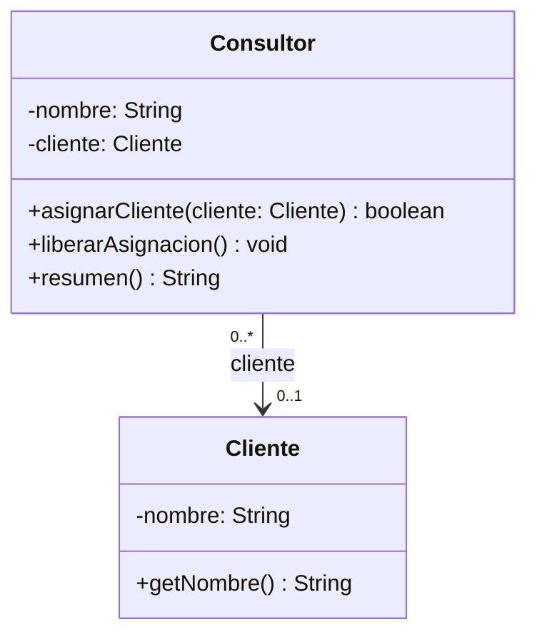

# Lab 01 · Consultor y cliente

**Tiempo: 9 minutos.** El código está completo. Investiga, interpreta y dibuja; no cambies las clases para forzar una clasificación.

## Contexto

Un consultor puede tener un cliente asignado o estar sin cliente. Un cliente no es una pieza del consultor y puede trabajar con distintos consultores. La aplicación solo necesita consultar al cliente desde el consultor.

## Lee y ejecuta

1. [Cliente.java](Cliente.java).
2. [Consultor.java](Consultor.java).
3. [S09Lab01Main.java](S09Lab01Main.java): **ejecuta este Main**.

Los nombres iniciales del programa son válidos. Las operaciones muestran cómo se acepta, rechaza o cambia un enlace. No necesitas añadir capturas ni nuevas pruebas obligatorias para este análisis.

**Qué observar:** Consultor mantiene un campo Cliente. Sigue las dos llamadas a asignarCliente con el mismo objeto tienda; después observa liberarAsignacion. Una nueva asignación válida reemplaza la anterior. No existe una referencia de regreso desde Cliente.

**Salida esperada:**

```text
Ana: sin cliente
Ana: Tienda Norte
Luis: Tienda Norte
Tras liberar a Ana:
Ana: sin cliente
Luis: Tienda Norte
Cliente original: Tienda Norte
Asignar null: false
Luis: Tienda Norte
```

### Tu tarea de UML

1. Lee las clases en el orden indicado y ejecuta el Main **sin modificarlo**. Compara la salida; no tienes que programar ni completar TODO.
2. Identifica las dos clases del dominio y el campo que mantiene el enlace. El Main prepara el escenario; no hace falta incluirlo en el diagrama del dominio. No dibujes ArrayList o String como clases adicionales.
3. Diseña un diagrama UML propio de **dos clases**: nombre, atributos importantes con tipos y visibilidad, operaciones principales con parámetros y retornos, relación, multiplicidad en ambos extremos y navegabilidad cuando corresponda. Puedes usar Mermaid `classDiagram` o una imagen legible.
4. Clasifica la relación principal como **asociación, agregación o composición**. Si eliges una relación todo–parte, identifica el todo y coloca el rombo en ese extremo.
5. Escribe solo tres justificaciones breves: **¿existe un todo–parte significativo?, ¿puede compartirse la misma instancia?, ¿qué evidencia del contexto y del código sostiene tu clasificación?** Una palabra o un `new` aislado no bastan.
6. Responde la variación conceptual de abajo en una frase. No la implementes ni hagas un segundo diagrama.

Entrega este diagrama y sus respuestas en una sección del README personal o del equipo que indique el docente. Para los cinco labs basta **una investigación común inicial** con definiciones propias y el enlace de la fuente consultada.

**Pista para las multiplicidades:** ¿Cuántos clientes puede tener un consultor a la vez? ¿Cuántos consultores pueden apuntar al mismo cliente? No confundas el número de objetos de este Main con el límite permitido por el modelo.

**Variación conceptual:** Una política nueva exige que todo consultor nazca con un cliente y nunca pueda quedar sin asignación. ¿Qué cambiaría en la multiplicidad?

# Lab 01 · Consultor y cliente

Autor: Yonder Maldonado Pabón

## Investigación común inicial

- **Asociación:** relación entre dos clases en la que un objeto conoce a otro y lo usa, sin que uno sea parte del otro. Cada uno existe por su cuenta.
- **Agregación:** relación todo–parte débil. El todo agrupa partes que ya existían y que pueden compartirse o seguir vivas fuera del todo. El rombo vacío va en el extremo del todo.
- **Composición:** relación todo–parte fuerte. Las partes pertenecen a un solo todo, se crean dentro de él y no se comparten ni se transfieren. El rombo lleno va en el extremo del todo.


## Diagrama UML



## Clasificación

**Asociación.** Navegabilidad de `Consultor` hacia `Cliente`.

## Justificaciones

1. **¿Existe un todo–parte significativo?** No. El enunciado dice que el cliente no es una pieza del consultor.
2. **¿Puede compartirse la misma instancia?** Sí. `ana` y `luis` apuntan al mismo objeto `tienda`.
3. **Evidencia:** `Consultor` guarda un campo `Cliente` que recibe por parámetro. `liberarAsignacion()` solo pone `cliente = null` y `Cliente` no tiene referencia de vuelta.

## Variación conceptual

Si todo consultor debe nacer con cliente, la multiplicidad del lado `Cliente` pasa de `0..1` a `1`.