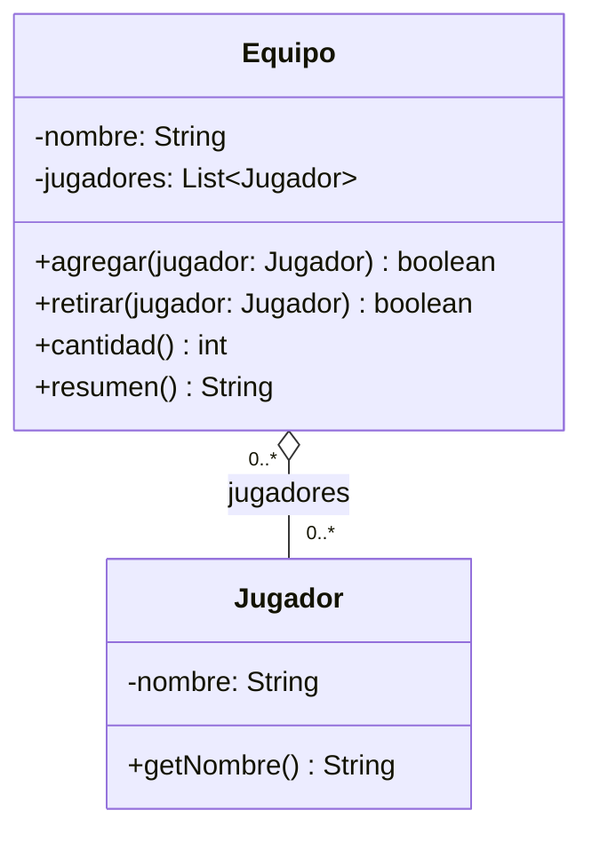

# Lab 02 · Equipo y jugadores

**Tiempo: 9 minutos.** El código está completo. Investiga, interpreta y dibuja; no cambies las clases para forzar una clasificación.

## Contexto

En este ejercicio un equipo es un conjunto deportivo de jugadores independientes. Una persona puede integrar, por ejemplo, club y selección al mismo tiempo. Retirarla de un equipo no la invalida ni obliga a retirarla de los otros.

## Lee y ejecuta

1. [Jugador.java](Jugador.java).
2. [Equipo.java](Equipo.java).
3. [S09Lab02Main.java](S09Lab02Main.java): **ejecuta este Main**.

Los nombres iniciales del programa son válidos. Las operaciones muestran cómo se acepta, rechaza o cambia un enlace. No necesitas añadir capturas ni nuevas pruebas obligatorias para este análisis.

**Qué observar:** El Main crea Sara y Leo antes de agregarlos. La misma referencia sara llega a dos equipos. Agregar dos veces esa referencia a un mismo equipo se rechaza; dos objetos diferentes podrían tener el mismo nombre. Sigue retirar para ver qué lista modifica.

**Salida esperada:**

```text
Azul (2): Sara Leo
Rojo (1): Sara
Repetir Sara en Azul: false
Retirar Sara de Azul: true
Azul (1): Leo
Rojo (1): Sara
Jugador original: Sara
```

### Tu tarea de UML

1. Lee las clases en el orden indicado y ejecuta el Main **sin modificarlo**. Compara la salida; no tienes que programar ni completar TODO.
2. Identifica las dos clases del dominio y el campo que mantiene el enlace. El Main prepara el escenario; no hace falta incluirlo en el diagrama del dominio. No dibujes ArrayList o String como clases adicionales.
3. Diseña un diagrama UML propio de **dos clases**: nombre, atributos importantes con tipos y visibilidad, operaciones principales con parámetros y retornos, relación, multiplicidad en ambos extremos y navegabilidad cuando corresponda. Puedes usar Mermaid `classDiagram` o una imagen legible.
4. Clasifica la relación principal como **asociación, agregación o composición**. Si eliges una relación todo–parte, identifica el todo y coloca el rombo en ese extremo.
5. Escribe solo tres justificaciones breves: **¿existe un todo–parte significativo?, ¿puede compartirse la misma instancia?, ¿qué evidencia del contexto y del código sostiene tu clasificación?** Una palabra o un `new` aislado no bastan.
6. Responde la variación conceptual de abajo en una frase. No la implementes ni hagas un segundo diagrama.

Entrega este diagrama y sus respuestas en una sección del README personal o del equipo que indique el docente. Para los cinco labs basta **una investigación común inicial** con definiciones propias y el enlace de la fuente consultada.

**Pista para las multiplicidades:** ¿El código exige un mínimo de jugadores por equipo? ¿Existe una restricción de un solo equipo por jugador? Usa las reglas particulares de este enunciado, no las de un deporte que conozcas.

**Variación conceptual:** La organización prohíbe que un jugador esté en dos equipos simultáneamente. ¿Qué multiplicidad y qué control habría que cambiar? No implementes el cambio.

# Lab 02 · Equipo y jugadores

Autor: Yonder Maldonado Pabón

## Diagrama UML



## Clasificación

**Agregación.** El rombo va en `Equipo` (el todo). Navegabilidad de `Equipo` hacia `Jugador`.

## Justificaciones

1. **¿Existe un todo–parte significativo?** Sí. El equipo agrupa jugadores, pero los jugadores son independientes.
2. **¿Puede compartirse la misma instancia?** Sí. `sara` está en `azul` y en `rojo` a la vez.
3. **Evidencia:** `agregar` recibe un `Jugador` ya creado (no hace `new`) y `retirar` solo lo quita de la lista. Sara sigue existiendo y sigue en Rojo. El código no exige un mínimo de jugadores ni limita a un equipo por jugador.

## Variación conceptual

La multiplicidad del lado `Jugador` pasaría de `0..*` a `0..1`, y `agregar` tendría que verificar que el jugador no esté ya en otro equipo.
